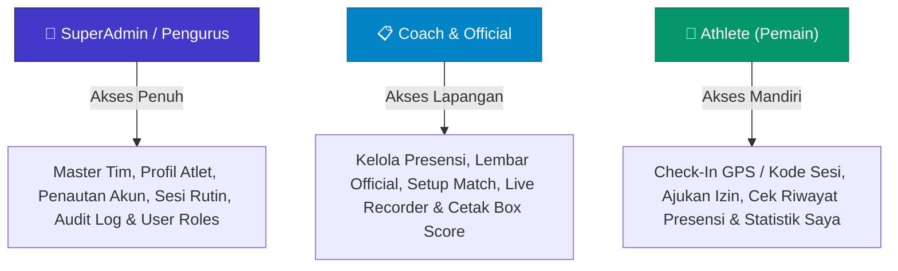
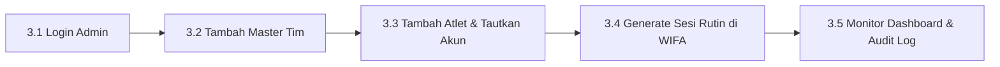
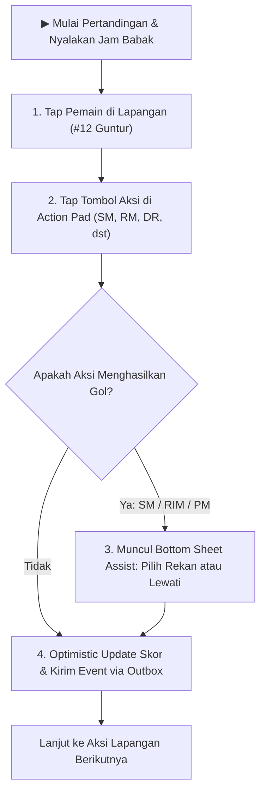
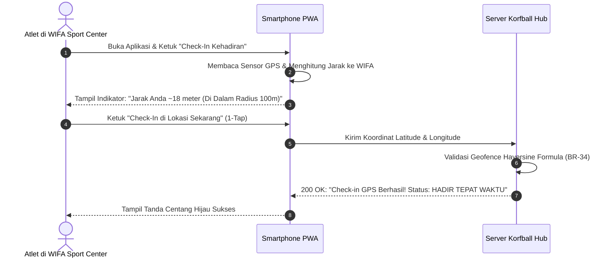

# 📖 BUKU PANDUAN PENGGUNA (USER GUIDEBOOK)
## KORFBALL HUB — APLIKASI PRESENSI KEHADIRAN & LIVE GAME STATISTICS
### PENGKAB KORFBALL BANTUL · VERSI PILOT TESTING (MVP v1.0)

> Dokumen ini dirancang sebagai panduan operasional komprehensif untuk pengujian lapangan (*Pilot Testing*) secara *end-to-end*. Panduan ini mencakup instalasi aplikasi *Progressive Web App* (PWA) di perangkat *mobile*, tata cara penggunaan berdasarkan hak akses (SuperAdmin, Pelatih/Official, dan Atlet), serta lembar skenario uji coba mandiri.

---

## 📑 DAFTAR ISI

1. [Pengenalan Aplikasi & Akun Pengujian](#1-pengenalan-aplikasi--akun-pengujian)
   - [1.1 Gambaran Umum Sistem](#11-gambaran-umum-sistem)
   - [1.2 Pembagian Peran & Batasan Akses (RBAC)](#12-pembagian-peran--batasan-akses-rbac)
   - [1.3 Akun Demo Resmi untuk Pengujian Pilot](#13-akun-demo-resmi-untuk-pengujian-pilot)
2. [Akses & Instalasi PWA (Mobile & Desktop)](#2-akses--instalasi-pwa-mobile--desktop)
   - [2.1 Akses Web Browser](#21-akses-web-browser)
   - [2.2 Instalasi PWA di Android (Google Chrome)](#22-instalasi-pwa-di-android-google-chrome)
   - [2.3 Instalasi PWA di iPhone / iPad (Apple Safari)](#23-instalasi-pwa-di-iphone--ipad-apple-safari)
   - [2.4 Pengaturan Izin Lokasi (GPS / Geolocation)](#24-pengaturan-izin-lokasi-gps--geolocation)
3. [Panduan Operasional: SuperAdmin / Pengurus](#3-panduan-operasional-superadmin--pengurus)
   - [3.1 Login & Dashboard Pengurus](#31-login--dashboard-pengurus)
   - [3.2 Manajemen Tim (Bantul & Lawan)](#32-manajemen-tim-bantul--lawan)
   - [3.3 Manajemen Data Atlet & Penautan Akun](#33-manajemen-data-atlet--penautan-akun)
   - [3.4 Pembuatan Sesi & Generate Jadwal Rutin](#34-pembuatan-sesi--generate-jadwal-rutin)
   - [3.5 Pengawasan Audit Log & Pengaturan Pengguna](#35-pengawasan-audit-log--pengaturan-pengguna)
4. [Panduan Operasional: Coach & Official](#4-panduan-operasional-coach--official)
   - [4.1 Menyiapkan Sesi & Menampilkan Kode Check-In Layar Penuh](#41-menyiapkan-sesi--menampilkan-kode-check-in-layar-penuh)
   - [4.2 Mengelola Lembar Presensi Official & Finalisasi](#42-mengelola-lembar-presensi-official--finalisasi)
   - [4.3 Membuat Jadwal Pertandingan & Pengaturan Lineup (K8 / K4)](#43-membuat-jadwal-pertandingan--pengaturan-lineup-k8--k4)
   - [4.4 Mengoperasikan Live Game Statistics Recorder](#44-mengoperasikan-live-game-statistics-recorder)
   - [4.5 Penggantian Pemain (Substitusi) & Manajemen Babak](#45-penggantian-pemain-substitusi--manajemen-babak)
   - [4.6 Meninjau Box Score & Mencetak Lembar Pertandingan Resmi A4](#46-meninjau-box-score--mencetak-lembar-pertandingan-resmi-a4)
5. [Panduan Operasional: Atlet (Pemain Putra & Putri)](#5-panduan-operasional-atlet-pemain-putra--putri)
   - [5.1 Dashboard Atlet & Kartu Sesi Hari Ini](#51-dashboard-atlet--kartu-sesi-hari-ini)
   - [5.2 Melakukan Self Check-In: Metode 1 (1-Tap GPS di WIFA Sport Center)](#52-melakukan-self-check-in-metode-1-1-tap-gps-di-wifa-sport-center)
   - [5.3 Melakukan Self Check-In: Metode 2 (Fallback Kode 6 Digit)](#53-melakukan-self-check-in-metode-2-fallback-kode-6-digit)
   - [5.4 Mengajukan & Membatalkan Izin Latihan (Excuse Request)](#54-mengajukan--membatalkan-izin-latihan-excuse-request)
   - [5.5 Memantau Tingkat Kehadiran & Statistik Performa Pribadi](#55-memantau-tingkat-kehadiran--statistik-performa-pribadi)
6. [Lembar Checklist Skenario Uji Coba Pilot (End-to-End)](#6-lembar-checklist-skenario-uji-coba-pilot-end-to-end)
7. [Pusat Bantuan & Penanganan Masalah (Troubleshooting & FAQ)](#7-pusat-bantuan--penanganan-masalah-troubleshooting--faq)

---

## 1. PENGENALAN APLIKASI & AKUN PENGUJIAN

### 1.1 Gambaran Umum Sistem
**Korfball Hub** adalah platform operasional terpadu yang dibangun khusus untuk mendukung pembinaan atlet korfball di Pengkab Korfball Bantul. Aplikasi ini menggabungkan dua modul inti:
1. **Presensi Kehadiran Digital (Hybrid Attendance)**: Memadukan validasi titik radius lokasi GPS perangkat atlet (*geofencing*) di lokasi latihan resmi (**WIFA SPORT CENTER**), cadangan kode sesi 6-karakter acak, serta lembar kendali manual bagi pelatih/official.
2. **Live Game Statistics Recorder**: Pencatat statistik pertandingan *real-time* tepi lapangan berbasis web/PWA yang menggantikan borang kertas manual (*Score Sheet IKF*), dilengkapi penghitung otomatis efisiensi pemain (*Player Efficiency Rating* / EFF), grafik tren pertandingan, serta cetak laporan resmi A4.

Aplikasi dirancang responsif *mobile-first* dan dapat dipasang langsung di layar beranda (*Home Screen*) gawai Android maupun iOS tanpa perlu mengunduh lewat Google Play Store atau Apple App Store.

---

### 1.2 Pembagian Peran & Batasan Akses (RBAC)

Sistem menerapkan prinsip *Least Privilege* dengan pemisahan tegas antara 3 tingkatan pengguna:

* **SuperAdmin / Manager (`admin`)**: Memiliki otoritas tertinggi untuk mengonfigurasi master data tim, profil atlet, menautkan akun login ke profil atlet, membuat jadwal sesi latihan rutin, melihat audit log sensitif, dan mengelola role pengguna.
* **Coach & Official (`coach`)**: Memiliki hak operasional lapangan penuh. Dapat membuat dan memfinalisasi sesi presensi, menampilkan kode check-in, mengubah status kehadiran official (`H/T/I/A`), membuat pertandingan, mengoperasikan live recorder statistik, melakukan pergantian pemain, serta mencetak lembar skor resmi.
* **Athlete (`athlete`)**: Dibatasi hanya untuk profil pribadinya sendiri. Atlet **hanya** dapat melakukan check-in pada sesi aktif hari ini, mengajukan izin latihan, melihat riwayat kehadiran pribadi, dan melihat statistik pertandingannya sendiri. Atlet **tidak dapat** melihat kode rahasia check-in di menu jadwal, tidak dapat mengubah status pemain lain, dan tidak dapat mencatat pertandingan.

---

### 1.3 Akun Demo Resmi untuk Pengujian Pilot

Untuk keperluan *pilot testing*, database telah di-seed dengan akun siap pakai berikut:

| Role | Nama Pengguna / Profil | Alamat Email | Password | Kegunaan Pengujian |
|---|---|---|---|---|
| **SuperAdmin** | Admin Korfball Bantul | `admin@korfballbantul.id` | `Admin123!` | Konfigurasi sistem, tim, atlet, sesi, audit log |
| **Coach & Official** | Pelatih Bantul Official | `coach@korfballbantul.id` | `Coach123!` | Kelola presensi lapangan, live stat recorder, box score |
| **Athlete (Putri)** | Rukmi Sari (#1) | `rukmi@korfballbantul.id` | `Athlete123!` | Uji coba check-in GPS & pengajuan izin atlet putri |
| **Athlete (Putra)** | Guntur Saputra (#12) | `guntur@korfballbantul.id` | `Athlete123!` | Uji coba check-in GPS & pembatalan izin atlet putra |
| **Athlete (Cadangan)**| Irfan Hakim (#4 L) | `irfan@korfballbantul.id` | `Athlete123!` | Pengujian rotasi/substitusi pemain putra |
| **Athlete (Cadangan)**| Rista Melani (#3 P) | `rista@korfballbantul.id` | `Athlete123!` | Pengujian rotasi/substitusi pemain putri |
| **Athlete (Cadangan)**| Jeni Ananda (#7 P) | `jeni@korfballbantul.id` | `Athlete123!` | Pengujian check-in keterlambatan |

> [!IMPORTANT]
> Password di atas bersifat *case-sensitive* (perhatikan huruf besar, angka, dan tanda seru `!`). Pada saat peluncuran produksi sesungguhnya, seluruh pengguna wajib menggunakan password rahasia masing-masing.

---

## 2. AKSES & INSTALASI PWA (MOBILE & DESKTOP)

Aplikasi Korfball Hub telah dikonfigurasi sebagai *Progressive Web App* (PWA) berstandar modern. Aplikasi dapat diakses melalui browser biasa, namun **sangat disarankan di-install ke layar utama (*Home Screen*) smartphone** untuk kemudahan akses dan pengalaman layaknya aplikasi *native*.

### 2.1 Akses Web Browser
1. Buka browser favorit Anda (Google Chrome di Android/PC, Safari di iOS/macOS).
2. Ketikkan URL aplikasi:
   * **Lingkungan Development / Lokal**: `http://localhost:3000` (atau IP lokal jaringan Wi-Fi, misalnya `http://192.168.1.X:3000`).
   * **Lingkungan Pilot / Staging Production**: URL deployment Vercel resmi (misalnya: `https://korfball-hub.vercel.app`).
3. Halaman akan langsung mengarahkan Anda ke layar login (`/login`).

---

### 2.2 Instalasi PWA di Android (Google Chrome)

1. Buka halaman aplikasi melalui aplikasi **Google Chrome** di HP Android Anda.
2. Lakukan login menggunakan akun Anda.
3. Setelah masuk ke halaman Dashboard, sistem secara otomatis menampilkan spanduk (*banner*) biru di bagian atas:
   > 📲 **Install Aplikasi Korfball Hub** — Pasang di HP untuk kemudahan presensi GPS dan pencatatan pertandingan offline.
4. Ketuk tombol **"Install Sekarang"**.
5. Dialog konfirmasi sistem Android akan muncul: ketuk **"Install"** / **"Tambahkan"**.
6. Ikon **Korfball Hub** akan muncul di daftar aplikasi HP Anda dan dapat dibuka tanpa bilah navigasi browser (*fullscreen standalone mode*).

*Alternatif jika banner tidak muncul:*
* Ketuk ikon **Titik Tiga (⋮)** di pojok kanan atas browser Google Chrome.
* Pilih opsi **"Install aplikasi"** atau **"Tambahkan ke Layar Utama" (Add to Home screen)**.
* Ikuti petunjuk di layar hingga proses instalasi selesai.

---

### 2.3 Instalasi PWA di iPhone / iPad (Apple Safari)

Perangkat Apple iOS mewajibkan pemasangan PWA melalui peramban resmi **Safari**:
1. Buka tautan aplikasi menggunakan browser **Safari** (bukan Chrome/Firefox iOS).
2. Di bilah menu bawah Safari, ketuk tombol **Share / Bagikan** (ikon kotak dengan panah mengarah ke atas `⎋`).
3. Gulir menu ke bawah dan ketuk opsi **"Add to Home Screen"** (*Tambahkan ke Layar Utama*).
4. Beri nama aplikasi (default: `Korfball Hub`), lalu ketuk **"Add"** (*Tambah*) di pojok kanan atas.
5. Ikon Korfball Hub siap dibuka langsung dari layar beranda iPhone Anda.

---

### 2.4 Pengaturan Izin Lokasi (GPS / Geolocation)

Fitur utama *Self Check-In* mengandalkan sensor GPS gawai untuk memvalidasi radius kehadiran di **WIFA SPORT CENTER**:

#### Pada Android (Chrome):
1. Saat pertama kali mengetuk tombol **"Check-In di Lokasi Sekarang"**, browser akan memunculkan *pop-up*:
   > *"aplikasi.korfball.id ingin mengakses lokasi perangkat ini"*
2. Pilih opsi **"Izinkan saat menggunakan aplikasi"** (*Allow while using app*).
3. Pastikan tombol saklar **Lokasi / GPS** di panel notifikasi atas HP Anda dalam posisi **Aktif** (*High Accuracy*).

#### Pada iOS (Safari):
1. Buka **Pengaturan (Settings)** iPhone Anda.
2. Pilih **Privasi & Keamanan (Privacy & Security)** > **Layanan Lokasi (Location Services)** > pastikan **Aktif**.
3. Gulir ke bawah, pilih **Situs Web Safari (Safari Websites)** > pilih **Saat Menggunakan Aplikasi (While Using the App)** dan aktifkan opsi **Lokasi Tepat (Precise Location)**.

---

## 3. PANDUAN OPERASIONAL: SUPERADMIN / PENGURUS

Sebagai SuperAdmin, Anda bertindak sebagai administrator sistem yang menyiapkan data master sebelum musim latihan dan pertandingan dimulai.

### 3.1 Login & Dashboard Pengurus
1. Buka halaman `/login`.
2. Masukkan email `admin@korfballbantul.id` dan password `Admin123!`.
3. Setelah login berhasil, Anda disambut oleh **Dashboard Pengurus** yang menampilkan:
   * **Widget Ringkasan**: Total Atlet Terdaftar, Total Tim, Sesi Latihan Bulan Ini, Pertandingan Aktif.
   * **Grafik Analitik**: Tren Kehadiran Latihan 30 Hari Terakhir, Distribusi Skor, dan Leaderboard Efisiensi.
   * **Navigasi Sidebar Lengkap**: Akses cepat ke Tim, Atlet, Sesi Latihan, Pertandingan, Statistik, Log Audit, dan Kelola Pengguna.

---

### 3.2 Manajemen Tim (Bantul & Lawan)
1. Buka menu **Tim** (`/teams`) pada sidebar.
2. Anda akan melihat daftar tim yang terdaftar (contoh: *Korfball Kab. Bantul*, *Kab. Klaten*, *Kota Tangerang Selatan*).
3. **Membuat Tim Baru**:
   * Klik tombol **"+ Tambah Tim"**.
   * Isi **Nama Tim** (misal: `Kontingen Sleman`).
   * Isi **Singkatan / Kode** (misal: `SLM`, maksimal 4 huruf).
   * Pilih tipe tim: centang **Tim Internal Bantul** jika merupakan tim asuhan sendiri, atau biarkan tidak tercentang untuk tim lawan tanding.
   * Klik **Simpan**.

---

### 3.3 Manajemen Data Atlet & Penautan Akun (*User Linking*)

> [!IMPORTANT]
> **Poin Kritis**: Agar seorang atlet bisa melakukan *Self Check-In* melalui HP-nya, profil atlet di database **wajib ditautkan ke akun login pengguna (*user_id*)**.

1. Buka menu **Atlet** (`/athletes`).
2. Tabel menampilkan nama lengkap, nomor punggung, jenis kelamin (L/P), posisi utama, tim, serta status tautan akun.
3. **Menautkan Akun User ke Profil Atlet**:
   * Cari atlet yang belum tertaut akun (kolom Akun Pengguna bertuliskan badge abu-abu *Belum Ditautkan*).
   * Klik tombol **Edit (Ikon Pensil)** pada baris atlet tersebut.
   * Pada *dropdown* **Tautkan Akun Pengguna**, pilih alamat email akun login atlet bersangkutan (misalnya akun `rukmi@korfballbantul.id` untuk atlet *Rukmi Sari*).
   * Klik **Perbarui Data**.
   * Seketika itu juga, saat atlet tersebut login, sistem akan mengenalinya sebagai profil atlet resmi dan memunculkan widget Check-In mandiri.

---

### 3.4 Pembuatan Sesi & Generate Jadwal Rutin

Sistem Korfball Hub telah mengadopsi jadwal rutin resmi Pengkab Korfball Bantul di **WIFA SPORT CENTER**:
* **Selasa**: Pukul 18:00 – 20:00 WIB
* **Sabtu**: Pukul 19:00 – 21:00 WIB

#### Cara A: Generate Jadwal Rutin Otomatis (Rekomendasi Awal Bulan)
1. Buka menu **Sesi Latihan** (`/sessions`).
2. Klik tombol **"⚡ Generate Sesi Rutin"** di sebelah tombol Tambah Sesi.
3. Dialog pop-up yang responsif akan muncul:
   * Pilih **Tim Sasaran**: `Korfball Kab. Bantul`.
   * Tentukan **Rentang Tanggal**: Tanggal Mulai s/d Tanggal Selesai (misalnya dari tanggal 1 sampai 30 bulan berjalan).
   * Konfirmasi Hari Rutin: **Selasa (18:00–20:00 WIB)** dan **Sabtu (19:00–21:00 WIB)**.
   * **Lokasi Default**: Otomatis terisi **WIFA SPORT CENTER** (`-7.900181586573576, 110.32812616243315`) dengan radius presensi **100 meter**.
   * Toleransi Keterlambatan: 15 menit.
4. Klik **"Generate Jadwal"**. Sistem akan membuat seluruh sesi latihan selama 1 bulan penuh secara instan dengan kode check-in acak dan koordinat GPS resmi!

#### Cara B: Membuat Sesi Tunggal secara Manual
1. Pada halaman **Sesi Latihan**, klik **"+ Buat Sesi Baru"**.
2. Form 2-kolom modern akan terbuka:
   * **Kolom Kiri (Detail Sesi)**: Judul sesi, tipe (Latihan Rutin / Scrimmage / Pertandingan Resmi), tanggal, jam mulai, jam selesai, toleransi telat (menit), dan catatan pelatih.
   * **Kolom Kanan (Lokasi & Geofence)**:
     - Pilih Preset Cepat: **WIFA Sport Center (Default)**.
     - Peta interaktif Leaflet akan otomatis menampilkan pin di atas gedung WIFA Sport Center beserta lingkaran biru radius 100 meter.
     - *(Opsional)* Jika latihan diadakan di tempat lain, Anda dapat mengetuk titik mana saja di peta atau mengklik **"Gunakan Lokasi Saya Saat Ini"**.
3. Klik **"Simpan Sesi"**.

---

### 3.5 Pengawasan Audit Log & Pengaturan Pengguna
1. Buka menu **Audit Logs** (`/audit-logs`) untuk memantau integritas data. Setiap aksi penting (perubahan skor, pergantian status presensi manual, penautan akun) tercatat dengan nama operator, alamat IP, dan waktu kejadian.
2. Buka menu **Pengguna** (`/users`) untuk mengundang pelatih baru atau mereset password pengguna yang terkendala.

---

## 4. PANDUAN OPERASIONAL: COACH & OFFICIAL

Sebagai Pelatih atau Official Pertandingan, Anda memegang peranan sentral dalam memimpin presensi di lapangan serta mengoperasikan pencatat statistik pertandingan secara *live*.

### 4.1 Menyiapkan Sesi & Menampilkan Kode Check-In Layar Penuh

Ketika Anda tiba di lapangan latihan (**WIFA SPORT CENTER**):
1. Login menggunakan akun `coach@korfballbantul.id` (password `Coach123!`).
2. Masuk ke menu **Sesi Latihan** (`/sessions`).
3. Cari sesi latihan hari ini yang berstatus **SCHEDULED**.
4. Di samping nama sesi, klik tombol **"Tampilkan Kode Check-In"** (ikon kunci / QR).
5. Modal layar penuh akan menampilkan **6 digit kode sesi** dengan huruf kapital besar (misal: `K8B9X2`).
6. Tunjukkan layar HP/laptop Anda kepada atlet yang mengalami kendala GPS indoor agar mereka dapat melakukan presensi cadangan (*fallback*).

---

### 4.2 Mengelola Lembar Presensi Official & Finalisasi

Untuk memantau presensi atlet yang sedang berlangsung:
1. Pada daftar sesi, klik tombol **"Buka Lembar Presensi"** (ikon daftar centang).
2. Anda akan diarahkan ke halaman **Official Attendance Sheet** (`/sessions/[id]/attendance`).
3. Halaman ini memperbarui data kehadiran secara otomatis setiap 10 detik:
   * Atlet yang berhasil check-in via GPS akan bertanda badge hijau **HADIR (GPS · X meter)**.
   * Atlet yang check-in menggunakan kode akan bertanda badge hijau **HADIR (KODE)**.
   * Atlet yang check-in melewati batas toleransi 15 menit otomatis bertanda kuning **TERLAMBAT**.
   * Atlet yang mengajukan izin sebelumnya akan berstatus biru **IZIN** lengkap dengan alasan yang dituliskan.
4. **Intervensi Manual oleh Pelatih**:
   * Jika ada atlet yang hadir namun tidak membawa smartphone, pelatih dapat langsung mengetuk tombol status `H` (Hadir), `T` (Terlambat), `I` (Izin), atau `A` (Alpa) pada baris nama atlet bersangkutan.
   * Jika seluruh atlet di lapangan sudah hadir, pelatih dapat menekan tombol **"Tandai Semua Hadir"**.
5. **Finalisasi Sesi Latihan (Kunci Data)**:
   * Setelah sesi latihan selesai, klik tombol **"Finalisasi Sesi"** di pojok kanan atas.
   * Sistem akan mengonfirmasi penutupan sesi.
   * **Konsekuensi**: Status sesi berubah menjadi **COMPLETED**. Seluruh atlet aktif yang belum memiliki catatan presensi akan **otomatis diubah menjadi ALPA (ABSENT)** oleh sistem (aturan BR-12).

---

### 4.3 Membuat Jadwal Pertandingan & Pengaturan Lineup (K8 / K4)

Korfball adalah olahraga bola keranjang unik yang menjunjung kesetaraan gender. Pertandingan standar (**K8**) mewajibkan susunan pemain seimbang.

1. Buka menu **Pertandingan** (`/matches`), lalu klik **"+ Buat Pertandingan"**.
2. Isi informasi dasar:
   * **Format Pertandingan**: Pilih **K8 (8 Pemain: 4 Putra & 4 Putri)** atau **K4 (4 Pemain: 2 Putra & 2 Putri)**.
   * **Tim Tuan Rumah (Home)**: Pilih tim internal Bantul.
   * **Tim Tamu (Away)**: Pilih tim lawan.
   * **Durasi Babak**: Standar turnamen adalah **2 x 20 menit** atau **4 x 10 menit**.
   * **Venue**: Tuliskan nama venue (contoh: `WIFA SPORT CENTER`).
3. Klik **Lanjut ke Lineup Pemain**:
   * Sistem menampilkan pembagian kuota gender secara ketat.
   * Pilih **8 Pemain Starter**: Wajib memilih tepat **4 Atlet Putra** dan **4 Atlet Putri**.
   * Pilih pemain cadangan (*bench*) di kolom cadangan.
   * Validasi sistem akan mencegah penyimpanan jika syarat 4L + 4P belum terpenuhi (aturan BR-18).
4. Klik **Simpan Pertandingan**.

---

### 4.4 Mengoperasikan Live Game Statistics Recorder

Saat pertandingan dimulai, buka menu pertandingan dan klik **"Mulai Rekam Statistik"** (`/matches/[id]/record`).

#### Struktur Antarmuka Recorder:
* **Bagian Atas (Scoreboard & Match Clock)**:
  - Skor *real-time* Home vs Away.
  - Indikator Babak (Period 1, 2, dst.).
  - Tombol Jam: **Play / Pause** waktu pertandingan.
  - Indikator Outbox Jaringan: Menampilkan status **Online (Tersinkron)** atau **Offline (X Pending)**.
* **Bagian Kiri (Daftar Pemain di Lapangan)**:
  - 8 Pemain starter yang sedang aktif di lapangan (dibedakan dengan ikon L/P).
  - Ketuk nama pemain yang melakukan aksi di lapangan.
* **Bagian Kanan (Action Pad / Papan Tombol Aksi)**:
  - **Tembakan Masuk (+1 Angka)**:
    - `SM` (*Shoot Made* / Tembakan Jauh Masuk).
    - `RIM` (*Running-in Made* / Layup Terobosan Masuk).
    - `PM` (*Penalty Made* / Lemparan Bebas Penalti Masuk).
    - `FKM` (*Free Pass Made* / Lemparan Bebas Area Masuk).
  - **Tembakan Meleset**:
    - `SA` (*Shoot Attempt* / Tembakan Jauh Meleset).
    - `RIA` (*Running-in Attempt* / Terobosan Meleset).
    - `PA` (*Penalty Attempt* / Penalti Meleset).
  - **Rebound & Penguasaan Bola**:
    - `DR` (*Defensive Rebound* / Rebound Bertahan).
    - `OR` (*Offensive Rebound* / Rebound Menyerang).
    - `TOV` (*Turnover* / Kehilangan Bola / Salah Umpan).
    - `D` (*Deck* / Intersep Memotong Umpan).
  - **Pelanggaran & Disiplin**:
    - `F` (*Foul* / Pelanggaran Biasa).
    - `YC` (*Yellow Card* / Kartu Kuning - Peringatan).
    - `RC` (*Red Card* / Kartu Merah - Dikeluarkan dari Lapangan).

#### Pencatatan Assist:
Setiap kali Anda menekan tombol gol (`SM`, `RIM`, `PM`), layar akan otomatis memunculkan jendela pilihan **Pemberi Assist**. Pilih nama rekan setim yang memberikan umpan matang, atau pilih tombol **"Tanpa Assist"** jika gol tercipta lewat aksi individu.

---

### 4.5 Penggantian Pemain (Substitusi) & Manajemen Babak

#### Melakukan Substitusi Pemain (Aturan Korfball IKF):
1. Ketuk tombol **"Pergantian Pemain (Substitusi)"** di panel atas recorder.
2. Pilih pemain yang akan ditarik keluar dari lapangan.
3. Pilih pemain pengganti yang masuk dari bangku cadangan.
4. **Aturan Kesetaraan Gender (BR-22)**:
   * Atlet Putra **hanya boleh digantikan oleh Atlet Putra**.
   * Atlet Putri **hanya boleh digantikan oleh Atlet Putri**.
   * Pemain yang telah terkena Kartu Merah (`RC`) tidak dapat dimasukkan kembali ke lapangan.
5. Klik **Konfirmasi Substitusi**. Susunan pemain aktif di layar seketika berganti.

#### Manajemen Babak & Akhir Pertandingan:
1. Ketika waktu babak habis, jeda jam pertandingan dan klik **"Selesaikan Babak"**.
2. Masuki babak berikutnya dengan mengklik **"Mulai Babak 2"**.
3. Jika seluruh babak telah selesai dan outbox sinkronisasi berstatus 0 pending, klik tombol **"Selesaikan Pertandingan"** (*Finish Match*). Pertandingan akan terkunci permanen dan skor dibukukan ke klasemen turnamen.

---

### 4.6 Meninjau Box Score & Mencetak Lembar Pertandingan Resmi A4

1. Buka rute **Box Score** (`/matches/[id]/box-score`).
2. Tabel statistik lengkap menampilkan performa setiap atlet:
   * **Persentase Tembakan**: `%FGS`, `%FGR`, `%P`.
   * **Total Rebound**: Rebound Bertahan + Menyerang.
   * **Turnovers & Steals/Deck**.
   * **Efisiensi Pemain (EFF)** yang dihitung secara otomatis dengan rumus resmi:
     $$\text{EFF} = (\text{Poin} + \text{Rebound} + \text{Assist} + \text{Deck}) - (\text{Tembakan Meleset} + \text{Turnover} + \text{Pelanggaran})$$
3. **Mencetak Laporan Pertandingan Format A4**:
   * Buka menu **Cetak Laporan** (`/matches/[id]/report`).
   * Tampilan akan menyajikan layout standar lembar pertandingan resmi (*IKF Match Sheet*).
   * Tekan kombinasi tombol **Ctrl + P** (atau tombol *Cetak*) untuk mencetak ke kertas A4 Landscape atau menyimpannya sebagai file **PDF Resmi Pertandingan**.

---

## 5. PANDUAN OPERASIONAL: ATLET (PEMAIN PUTRA & PUTRI)

Sebagai atlet, Anda dapat melakukan presensi secara mandiri dari smartphone Anda tanpa antre di borang manual.

### 5.1 Dashboard Atlet & Kartu Sesi Hari Ini
1. Buka aplikasi Korfball Hub di HP Anda (ikon PWA atau browser).
2. Login menggunakan akun email dan password atlet Anda (misal: `rukmi@korfballbantul.id` / `Athlete123!`).
3. Pada halaman beranda, Anda akan langsung melihat kartu utama:
   > 📌 **SESI LATIHAN HARI INI**  
   > **Latihan Rutin Selasa** · WIFA SPORT CENTER  
   > ⏰ 18:00 – 20:00 WIB · Toleransi 15 Menit

---

### 5.2 Melakukan Self Check-In: Metode 1 (1-Tap GPS di WIFA Sport Center)

Ini adalah metode tercepat dan paling disarankan saat Anda tiba di lokasi latihan:

1. Pastikan Anda sudah berada di area **WIFA SPORT CENTER**.
2. Pastikan **GPS / Layanan Lokasi** di smartphone Anda telah diaktifkan.
3. Di kartu sesi latihan hari ini, ketuk tombol hijau **"Check-In Kehadiran"**.
4. Modal check-in akan terbuka pada tab **"Lokasi GPS (1-Tap)"**.
5. Sistem akan membaca koordinat GPS perangkat Anda:
   * Anda akan melihat jarak Anda ke gedung WIFA Sport Center (misalnya: *Jarak terdeteksi: 24 meter dari venue*).
   * Badge status akan berwarna hijau bertuliskan **"Di Dalam Radius Presensi"**.
6. Ketuk tombol biru besar: **"Check-In di Lokasi Sekarang"**.
7. Layar akan menampilkan konfirmasi centang hijau:
   * **Status Kehadiran**: `HADIR TEPAT WAKTU` (jika sebelum 18:15 WIB) atau `HADIR TERLAMBAT` (jika setelah 18:15 WIB).
   * Jam check-in dan jarak GPS tercatat aman di server.

---

### 5.3 Melakukan Self Check-In: Metode 2 (Fallback Kode 6 Digit)

Jika Anda berlatih di bagian dalam gedung GOR tertutup di mana sinyal satelit GPS lemah (*timeout*) atau browser Anda tidak sengaja memblokir izin lokasi:
1. Ketuk tombol **"Check-In Kehadiran"**.
2. Pada bagian atas modal, beralih ke tab **"Kode 6 Digit"**.
3. Lihat layar proyektor atau tanyakan kepada Pelatih/Official kode 6 digit untuk sesi latihan hari tersebut (contoh: `K8B9X2`).
4. Ketikkan 6 karakter kode tersebut pada kotak input yang tersedia.
5. Ketuk tombol **"Kirim Kode Check-In"**.
6. Presensi Anda seketika tercatat valid.

---

### 5.4 Mengajukan & Membatalkan Izin Latihan (*Excuse Request*)

Jika Anda berhalangan hadir karena sakit, tugas sekolah/kuliah, atau dinas pekerjaan:
1. **Mengajukan Izin**:
   * Buka aplikasi **sebelum jam mulai latihan** (sebelum pukul 18:00 WIB).
   * Pada kartu sesi latihan hari ini, ketuk tombol **"Ajukan Izin"**.
   * Tuliskan alasan izin Anda secara jelas (contoh: *"Sakit demam, istirahat di rumah"* atau *"Ujian praktikum kampus"*).
   * Ketuk **"Kirim Pengajuan Izin"**. Status Anda pada lembar pelatih otomatis berubah menjadi **IZIN (EXCUSED)**.
2. **Membatalkan Izin**:
   * Jika urusan Anda selesai lebih awal dan Anda akhirnya bisa berangkat latihan, ketuk tombol **"Batalkan Izin"** di dashboard Anda.
   * Status Anda akan kembali normal sehingga Anda dapat melakukan check-in setibanya di WIFA Sport Center.

---

### 5.5 Memantau Tingkat Kehadiran & Statistik Performa Pribadi

* **Riwayat Kehadiran Mandiri (`/attendance/me`)**:
  - Melihat persentase kehadiran Anda selama 30 hari terakhir.
  - Memeriksa daftar tanggal latihan yang Anda ikuti, status ketepatan waktu, dan catatan izin.
* **Statistik Performa Pertandingan (`/stats/me`)**:
  - Memantau total poin yang Anda cetak sepanjang musim kompetisi.
  - Meninjau akurasi tembakan jauh (*Shoot Made %*), efektivitas terobosan (*Running-in %*), dan lemparan penalti.
  - Melihat angka kontribusi *Defensive Rebound*, *Assists*, serta rating efisiensi bertanding (*EFF*).

---

## 6. LEMBAR CHECKLIST SKENARIO UJI COBA PILOT (END-TO-END)

Gunakan lembar checklist ini sebagai acuan saat tim pengurus, pelatih, dan atlet melakukan uji coba sistem secara langsung di lapangan:

### Skenario 1: Verifikasi Instalasi PWA & Akses Role
- [ ] Pengguna membuka aplikasi lewat browser HP Android/iOS.
- [ ] Banner instalasi PWA muncul dan aplikasi berhasil ditambahkan ke Home Screen.
- [ ] Ikon aplikasi di Home Screen dapat dibuka dalam mode *standalone* tanpa bar peramban.
- [ ] Login menggunakan akun SuperAdmin (`admin@korfballbantul.id`) -> Menu lengkap muncul.
- [ ] Login menggunakan akun Coach (`coach@korfballbantul.id`) -> Menu operasional presensi & recorder aktif.
- [ ] Login menggunakan akun Athlete (`rukmi@korfballbantul.id`) -> Terbatas hanya pada kartu check-in dan profil pribadi.

### Skenario 2: Konfigurasi Tim & Penautan Profil Atlet oleh Admin
- [ ] Admin membuka menu `/athletes`.
- [ ] Admin memastikan atlet `Rukmi Sari (#1)` tertaut ke email `rukmi@korfballbantul.id`.
- [ ] Admin memastikan atlet `Guntur Saputra (#12)` tertaut ke email `guntur@korfballbantul.id`.
- [ ] Admin membuka menu `/sessions` dan memverifikasi jadwal latihan rutin Selasa & Sabtu di WIFA Sport Center.

### Skenario 3: Uji Coba Check-In GPS 1-Tap di WIFA Sport Center (Atlet)
- [ ] Atlet berada di area WIFA SPORT CENTER dengan GPS gawai aktif.
- [ ] Atlet membuka kartu sesi hari ini dan mengetuk "Check-In Kehadiran".
- [ ] Tab "Lokasi GPS" membaca koordinat dan menampilkan jarak (< 100 meter).
- [ ] Atlet mengetuk "Check-In di Lokasi Sekarang".
- [ ] Muncul notifikasi centang hijau: `HADIR TEPAT WAKTU` (atau `HADIR TERLAMBAT` jika melewati 15 menit).
- [ ] Lembar pelatih seketika menampilkan badge hijau dengan jarak meter GPS atlet.

### Skenario 4: Uji Coba Check-In Fallback Kode 6 Digit & Pengajuan Izin
- [ ] Pelatih membuka sesi dan mengklik "Tampilkan Kode Check-In" layar penuh.
- [ ] Atlet kedua (misal: Guntur) membuka tab "Kode 6 Digit" pada modal check-in.
- [ ] Atlet menginput 6 karakter kode yang tampil -> Presensi berhasil tercatat.
- [ ] Atlet ketiga (misal: Irfan) mengetuk "Ajukan Izin" sebelum jam sesi dimulai dan mengisi alasan.
- [ ] Pada lembar pelatih, status Irfan langsung tercatat sebagai `IZIN` dengan alasan yang sesuai.

### Skenario 5: Peninjauan Lembar Presensi & Finalisasi Sesi oleh Pelatih
- [ ] Pelatih membuka lembar presensi sesi (`/sessions/[id]/attendance`).
- [ ] Pelatih mengubah manual 1 orang atlet menjadi `HADIR` dengan mengetuk tombol `H`.
- [ ] Pelatih mengklik tombol "Finalisasi Sesi".
- [ ] Sesi berubah menjadi `COMPLETED`. Atlet yang tidak hadir atau tidak izin otomatis berstatus `ALPA (ABSENT)`.

### Skenario 6: Setup Pertandingan K8 & Validasi Gender (4L + 4P)
- [ ] Coach membuka menu `/matches/new`.
- [ ] Coach memilih Format K8, Tim Home (Bantul), Tim Away (Klaten), durasi babak 2x20 menit.
- [ ] Coach menyusun lineup: Memilih 4 Putra dan 4 Putri sebagai starter.
- [ ] Uji coba memilih 5 Putra dan 3 Putri -> Sistem menolak penyimpanan dan memberi pesan peringatan.
- [ ] Lineup valid tersimpan dengan benar.

### Skenario 7: Operasional Live Stat Recorder di Tepi Lapangan
- [ ] Coach membuka `/matches/[id]/record` dan menyalakan jam pertandingan (*Period 1*).
- [ ] Coach mengetuk pemain `#12 Guntur`, lalu mengetuk `SM` (*Shoot Made*).
- [ ] Bottom sheet Assist muncul: Coach memilih atlet `#1 Rukmi` sebagai pemberi assist.
- [ ] Skor Home otomatis bertambah menjadi 1 angka di papan skor.
- [ ] Coach mencatat pelanggaran `F` dan `DR` (Defensive Rebound).
- [ ] Uji coba kesalahan input: Coach mengetuk tombol `Undo` -> Aksi terakhir berhasil dibatalkan.
- [ ] Coach melakukan pergantian pemain: Atlet Putra diganti Atlet Putra cadangan (berhasil).

### Skenario 8: Box Score, Efisiensi Pemain (EFF) & Cetak Lembar Skor Resmi
- [ ] Coach menyelesaikan pertandingan (*Finish Match*).
- [ ] Buka halaman `/matches/[id]/box-score`: Periksa kesesuaian poin, tembakan meleset, dan nilai efisiensi (EFF).
- [ ] Buka halaman `/matches/[id]/report`: Tinjau pratinjau lembar skor resmi format A4.
- [ ] Klik Cetak / Print to PDF -> Dokumen tercetak rapi dalam format A4 Landscape 2 halaman.

---

## 7. PUSAT BANTUAN & PENANGANAN MASALAH (TROUBLESHOOTING & FAQ)

### ❓ Pertanyaan 1: Mengapa GPS mendeteksi saya berada di luar radius padahal saya sudah di WIFA Sport Center?
* **Penyebab**: Akurasi GPS smartphone terkadang membutuhkan waktu beberapa detik untuk mengunci satelit (*cold start*), terutama jika Anda berada di bawah atap baja tertutup.
* **Solusi**:
  1. Pastikan fitur **Akurasi Lokasi Tinggi (Google Location Accuracy)** di HP Android Anda dalam kondisi aktif.
  2. Buka aplikasi Google Maps sebentar agar sinyal GPS terkalibrasi.
  3. Jika masih mengalami kendala, **segera beralih ke Tab "Kode 6 Digit"** pada modal check-in dan minta kode 6 huruf dari pelatih. Anda tetap dapat presensi tepat waktu tanpa hambatan!

### ❓ Pertanyaan 2: Tombol "Check-In Kehadiran" tidak muncul di dashboard akun atlet saya?
* **Penyebab**: Akun login Anda belum ditautkan ke profil data atlet oleh SuperAdmin.
* **Solusi**: Hubungi SuperAdmin/Pengurus untuk membuka menu **Atlet**, mengedit profil nama Anda, dan memilih alamat email akun Anda pada kolom **Tautkan Akun Pengguna**.

### ❓ Pertanyaan 3: Apa yang terjadi jika atlet melakukan check-in melewati batas jam mulai latihan?
* **Ketentuan Sistem**:
  - Jika check-in dilakukan antara jam mulai s/d 15 menit setelahnya (misal: 18:00 – 18:15 WIB), status tercatat **HADIR TEPAT WAKTU (PRESENT)**.
  - Jika check-in dilakukan setelah toleransi 15 menit berakhir (misal: pukul 18:16 WIB ke atas), status otomatis tercatat **HADIR TERLAMBAT (LATE)**.
  - Perhitungan persentase kehadiran resmi tetap memperhitungkan hadir terlambat sesuai formula bobot kehadiran organisasi.

### ❓ Pertanyaan 4: Apakah aplikasi tetap bisa mencatat statistik jika sinyal internet di GOR mati saat pertandingan?
* **Jawaban**: **Bisa 100%!** Korfball Hub dilengkapi modul **IndexedDB Offline Outbox**:
  - Setiap kali Anda menekan aksi skor/rebound di recorder, aksi tersebut langsung dicatat di penyimpanan lokal HP Anda dan skor langsung bergerak (*optimistic UI*).
  - Indikator di pojok kanan atas akan menampilkan tanda *Oranye: X Pending*.
  - Begitu perangkat Anda terhubung kembali ke sinyal data/Wi-Fi, seluruh event yang tertunda akan **otomatis tersinkronisasi ke server** tanpa risiko duplikasi data (*idempotent safe*).

### ❓ Pertanyaan 5: Mengapa pelatih tidak bisa melakukan pergantian pemain putra dengan pemain putri?
* **Ketentuan Sistem**: Berdasarkan regulasi resmi *International Korfball Federation* (IKF) dan aturan bisnis sistem (BR-22), formasi K8 wajib mempertahankan keseimbangan 4 Putra dan 4 Putri di lapangan sepanjang laga. Pemain putra hanya boleh menggantikan pemain putra, dan pemain putri hanya boleh menggantikan pemain putri.

---

> **Sekretariat Pengkab Korfball Bantul**  
> *Sistem Informasi Presensi & Statistik Pertandingan Digital Korfball Hub*  
> Dokumentasi versi 1.0 — Siap Digunakan untuk Uji Coba Pilot Lapangan.
